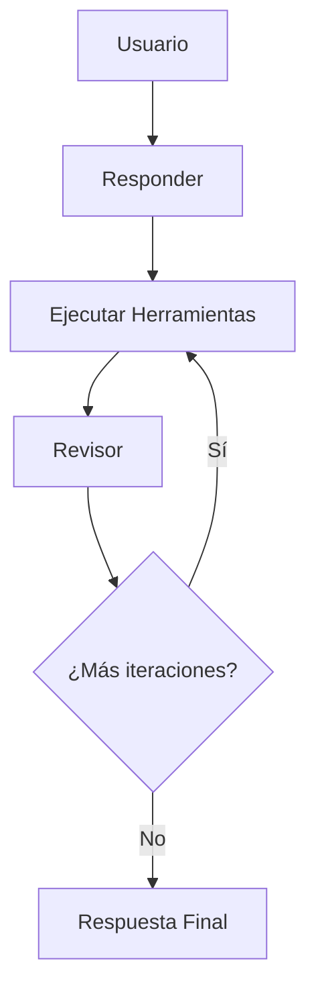

# LangGraph Reflection Actor Agent

Un agente de investigación basado en IA que utiliza el patrón de reflexión para generar respuestas detalladas y bien fundamentadas mediante la integración de múltiples herramientas de búsqueda web.

## 🚀 Características

- **Agente de Reflexión**: Implementa un patrón de reflexión donde el agente critica su propia respuesta y busca información adicional
- **Búsqueda Web Integrada**: Utiliza Tavily Search para obtener información actualizada de la web
- **Workflow de LangGraph**: Flujo de trabajo estructurado con múltiples nodos de procesamiento
- **Respuestas Citadas**: Genera respuestas con referencias y citas numéricas verificables
- **Control de Iteraciones**: Limita el número de iteraciones para evitar bucles infinitos
- **Logger Colorizado**: Sistema de logging con códigos de color para mejor visualización

## 🏗️ Arquitectura

El agente sigue un flujo de trabajo de tres etapas:

1. **Responder** (`first_responder`): Genera una respuesta inicial de ~500 palabras con reflexión y crítica
2. **Ejecutar Herramientas** (`execute_tools`): Realiza búsquedas web basadas en las consultas sugeridas
3. **Revisor** (`revisor`): Revisa y mejora la respuesta utilizando la nueva información encontrada



### Flujo de Mensajes

El sistema utiliza `MessageGraph` de LangGraph para orquestar el flujo de mensajes entre nodos:

- **HumanMessage**: Mensaje inicial del usuario con la consulta
- **ToolMessage**: Mensajes generados por las herramientas de búsqueda
- **AIMessage**: Respuestas generadas por el LLM

## 📋 Requisitos

- Python >= 3.10, < 4.0
- Poetry para gestión de dependencias
- API Key de OpenAI
- API Key de Tavily Search

## ⚡ Quick Start

¿Quieres empezar rápidamente? Lee la [Guía de Inicio Rápido (QUICKSTART.md)](QUICKSTART.md) para poner en marcha el proyecto en menos de 5 minutos.

## 🛠️ Instalación

1. **Clona el repositorio**:
   ```bash
   git clone <repository-url>
   cd langgraph-reflexion-actor-agent
   ```

2. **Instala las dependencias usando Poetry**:
   ```bash
   poetry install
   ```

3. **Configura las variables de entorno**:
   Crea un archivo `.env` en la raíz del proyecto:
   ```env
   OPENAI_API_KEY=tu_openai_api_key_aqui
   TAVILY_API_KEY=tu_tavily_api_key_aqui
   OPENAI_MODEL=gpt-4o-mini  # Opcional, por defecto usa gpt-5-nano
   ```

4. **Activa el entorno virtual**:
   ```bash
   poetry shell
   ```

## 🚀 Uso

### Uso Básico

```python
from main import graph

# Ejecutar el agente con una pregunta
result = graph.invoke(
    "Investiga acerca de la industria de telecomunicaciones en México y la reglamentación en el sector"
)

# Obtener la respuesta final
final_answer = result[-1].tool_calls[0]["args"]["answer"]
print(final_answer)

# Obtener las referencias
references = result[-1].tool_calls[0]["args"]["references"]
for i, ref in enumerate(references, 1):
    print(f"[{i}]. {ref}")
```

### Ejecutar desde la Línea de Comandos

```bash
poetry run python main.py
```

### Personalizar la Consulta

Edita el archivo `main.py` y modifica la variable `query`:

```python
query = "Tu pregunta de investigación aquí"
```

## 📁 Estructura del Proyecto

```
langgraph-reflexion-actor-agent/
├── main.py                 # Punto de entrada principal y configuración del grafo
├── chains.py               # Cadenas de procesamiento LLM y templates de prompts
├── schemas.py              # Modelos Pydantic para estructurar las respuestas
├── tool_executor.py        # Ejecutor de herramientas de búsqueda web
├── logger.py               # Sistema de logging con colores
├── pyproject.toml          # Configuración del proyecto y dependencias
├── poetry.lock             # Lock file de dependencias
├── flow.png                # Diagrama del flujo de trabajo
├── docs/                   # Documentación adicional
│   ├── API_REFERENCE.md    # Referencia de API
│   ├── ARCHITECTURE.md     # Guía de arquitectura detallada
│   ├── EXAMPLES.md         # Ejemplos de uso
│   └── ReflexionIvenstigationPaperMIT_2303.11366v4.pdf
└── README.md               # Este archivo
```

## 🔧 Configuración

### Modelo LLM

Por defecto, el proyecto utiliza el modelo especificado en la variable de entorno `OPENAI_MODEL` (por defecto `gpt-5-nano`). Puedes cambiar el modelo en el archivo `.env` o modificando directamente en `chains.py`:

```python
llm = ChatOpenAI(model="gpt-4o-mini")  # o cualquier otro modelo compatible
```

### Límite de Iteraciones

El número máximo de iteraciones está definido en `main.py`:

```python
MAX_ITERATIONS = 2  # Ajusta según tus necesidades
```

Esto controla cuántas veces el agente puede iterar entre la búsqueda de información y la revisión de su respuesta.

### Resultados de Búsqueda

El número máximo de resultados por consulta de búsqueda está configurado en `tool_executor.py`:

```python
tavily_tool = TavilySearch(max_results=5)  # Ajusta según tus necesidades
```

## 📊 Componentes Principales

### Schemas (`schemas.py`)

Define las estructuras de datos utilizadas por el agente:

- **`Reflection`**: Estructura para críticas de la respuesta
  - `missing`: Qué información falta
  - `superfluous`: Qué información es superflua
  
- **`AnswerQuestion`**: Estructura para respuestas iniciales
  - `answer`: Respuesta detallada (~500 palabras)
  - `reflection`: Reflexión sobre la respuesta
  - `search_queries`: Consultas de búsqueda sugeridas (1-3)
  
- **`ReviseAnswer`**: Estructura para respuestas revisadas (extiende `AnswerQuestion`)
  - Incluye todos los campos de `AnswerQuestion`
  - `references`: Lista de URLs o referencias como citas

### Chains (`chains.py`)

Define las cadenas de procesamiento del LLM:

- **`first_responder`**: Genera la respuesta inicial
- **`revisor`**: Revisa y mejora la respuesta con nueva información

Ambas cadenas utilizan prompts especializados que instruyen al modelo para:
1. Proporcionar respuestas detalladas
2. Reflexionar y criticar la respuesta
3. Recomendar consultas de búsqueda para mejoras

### Tool Executor (`tool_executor.py`)

Gestiona la ejecución de herramientas de búsqueda web:

- **`run_queries()`**: Ejecuta múltiples consultas de búsqueda en batch
- **`execute_tools`**: Nodo de LangGraph que envuelve las herramientas

### Logger (`logger.py`)

Sistema de logging con colores para mejor visualización:

- `log_info()`: Información general (cyan)
- `log_success()`: Operaciones exitosas (verde)
- `log_error()`: Errores (rojo)
- `log_warning()`: Advertencias (amarillo)
- `log_header()`: Encabezados destacados (púrpura/bold)

## 🔬 Investigación Base

Este proyecto está basado en el paper de investigación "Reflexion: Language Agents with Verbal Reinforcement Learning" del MIT (2023). El patrón de reflexión permite que el agente:

1. Genere una respuesta inicial
2. Critique su propia respuesta identificando deficiencias
3. Genere consultas de búsqueda para llenar vacíos de información
4. Revise y mejore la respuesta con la nueva información

Puedes encontrar el documento original en `docs/ReflexionIvenstigationPaperMIT_2303.11366v4.pdf`.

## 📚 Documentación Adicional

- [Referencia de API](./docs/API_REFERENCE.md) - Documentación detallada de todas las funciones y clases
- [Guía de Arquitectura](./docs/ARCHITECTURE.md) - Arquitectura detallada del sistema
- [Ejemplos de Uso](./docs/EXAMPLES.md) - Ejemplos prácticos de uso
- [Troubleshooting](./docs/TROUBLESHOOTING.md) - Resolución de problemas y FAQ

## 🧪 Desarrollo

### Formateo de Código

El proyecto incluye herramientas de formateo:

```bash
# Formatear código con black
poetry run black .

# Ordenar imports con isort
poetry run isort .
```

### Visualizar el Grafo

Para visualizar el grafo de LangGraph, descomenta las líneas en `main.py`:

```python
print(graph.get_graph().draw_mermaid())
graph.get_graph().print_ascii()
```

## 🤝 Contribuir

Las contribuciones son bienvenidas! Por favor:

1. Fork el proyecto
2. Crea una rama para tu feature (`git checkout -b feature/AmazingFeature`)
3. Commit tus cambios (`git commit -m 'Add some AmazingFeature'`)
4. Push a la rama (`git push origin feature/AmazingFeature`)
5. Abre un Pull Request

## 📄 Licencia

Este proyecto está bajo la Licencia MIT. Ver el archivo `LICENSE` para más detalles.

## 👨‍💻 Autor

**Gualberto Alejandro Sanchez Caceres**
- Email: sanchezga@globalhitss.com

## 🙏 Agradecimientos

- [LangGraph](https://github.com/langchain-ai/langgraph) por el framework de agentes
- [LangChain](https://github.com/langchain-ai/langchain) por las abstracciones de LLM
- [OpenAI](https://openai.com/) por los modelos de lenguaje
- [Tavily](https://tavily.com/) por las herramientas de búsqueda web
- MIT por la investigación en reflexión de agentes

## 📞 Soporte

Si encuentras algún problema o tienes preguntas, por favor abre un issue en el repositorio.
