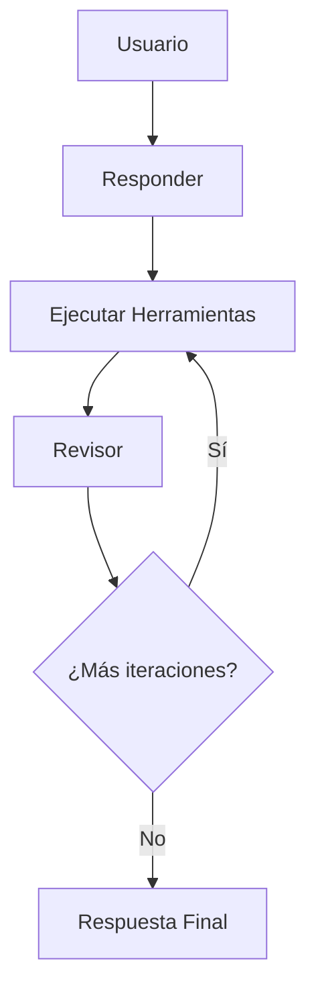

# LangGraph Reflection Actor Agent

Un agente de investigación basado en IA que utiliza el patrón de reflexión para generar respuestas detalladas y bien fundamentadas mediante la integración de múltiples herramientas de búsqueda web.

## 🚀 Características

- **Agente de Reflexión**: Implementa un patrón de reflexión donde el agente critica su propia respuesta y busca información adicional
- **Búsqueda Web Integrada**: Utiliza Tavily Search para obtener información actualizada de la web
- **Workflow de LangGraph**: Flujo de trabajo estructurado con múltiples nodos de procesamiento
- **Respuestas Citadas**: Genera respuestas con referencias y citas numéricas verificables
- **Control de Iteraciones**: Limita el número de iteraciones para evitar bucles infinitos

## 🏗️ Arquitectura

El agente sigue un flujo de trabajo de tres etapas:

1. **Responder** (`first_responder`): Genera una respuesta inicial de ~500 palabras
2. **Ejecutar Herramientas** (`execute_tools`): Realiza búsquedas web basadas en las consultas sugeridas
3. **Revisor** (`revisor`): Revisa y mejora la respuesta utilizando la nueva información encontrada



## 📋 Requisitos

- Python >= 3.10
- Poetry para gestión de dependencias
- API Key de OpenAI
- API Key de Tavily Search

## 🛠️ Instalación

1. **Clona el repositorio**:
   ```bash
   git clone <repository-url>
   cd langgraph-reflexion-actor-agent
   ```

2. **Instala las dependencias usando Poetry**:
   ```bash
   poetry install
   ```

3. **Configura las variables de entorno**:
   Crea un archivo `.env` en la raíz del proyecto:
   ```env
   OPENAI_API_KEY=tu_openai_api_key_aqui
   TAVILY_API_KEY=tu_tavily_api_key_aqui
   ```

4. **Activa el entorno virtual**:
   ```bash
   poetry shell
   ```

## 🚀 Uso

### Uso Básico

```python
from main import graph

# Ejecutar el agente con una pregunta
result = graph.invoke(
    "Escribe un artículo sobre la industria de telecomunicaciones en México y la reglamentación en el sector"
)

# Obtener la respuesta final
final_answer = result[-1].tool_calls[0]["args"]["answer"]
print(final_answer)

# Obtener las referencias
references = result[-1].tool_calls[0]["args"]["references"]
for i, ref in enumerate(references, 1):
    print(f"{i}. {ref}")
```

### Ejecutar desde la Línea de Comandos

```bash
python main.py
```

## 📁 Estructura del Proyecto

```
langgraph-reflexion-actor-agent/
├── main.py              # Punto de entrada principal y configuración del grafo
├── chains.py            # Cadenas de procesamiento LLM y templates de prompts
├── schemas.py           # Modelos Pydantic para estructurar las respuestas
├── tool_executor.py     # Ejecutor de herramientas de búsqueda web
├── pyproject.toml       # Configuración del proyecto y dependencias
├── poetry.lock          # Lock file de dependencias
├── flow.png             # Diagrama del flujo de trabajo
├── docs/                # Documentación adicional
│   └── ReflexionIvenstigationPaperMIT_2303.11366v4.pdf
└── README.md            # Este archivo
```

## 🔧 Configuración

### Modelo LLM
Por defecto, el proyecto utiliza `o4-mini` de OpenAI. Puedes cambiar el modelo modificando la variable `llm` en `chains.py`:

```python
llm = ChatOpenAI(model="gpt-4o-mini")  # o cualquier otro modelo compatible
```

### Límite de Iteraciones
El número máximo de iteraciones está definido en `main.py`:

```python
MAX_ITERATIONS = 2  # Ajusta según tus necesidades
```

### Resultados de Búsqueda
El número máximo de resultados por consulta de búsqueda está configurado en `tool_executor.py`:

```python
tavily_tool = TavilySearch(max_results=5)  # Ajusta según tus necesidades
```

## 📚 Documentación Adicional

- [Documentación de API](./docs/API_REFERENCE.md)
- [Guía de Arquitectura](./docs/ARCHITECTURE.md)
- [Ejemplos de Uso](./docs/EXAMPLES.md)
- [Guía de Contribución](./docs/CONTRIBUTING.md)

## 🔬 Investigación Base

Este proyecto está basado en el paper de investigación "Reflexion: Language Agents with Verbal Reinforcement Learning" del MIT (2023). Puedes encontrar el documento original en `docs/ReflexionIvenstigationPaperMIT_2303.11366v4.pdf`.

## 🤝 Contribuir

¡Las contribuciones son bienvenidas! Por favor, lee nuestra [Guía de Contribución](./docs/CONTRIBUTING.md) para más detalles.

## 📄 Licencia

Este proyecto está bajo la Licencia MIT. Ver el archivo `LICENSE` para más detalles.

## 👨‍💻 Autor

**Gualberto Alejandro Sanchez Caceres**
- Email: sanchezga@globalhitss.com

## 🙏 Agradecimientos

- LangGraph por el framework de agentes
- OpenAI por los modelos de lenguaje
- Tavily por las herramientas de búsqueda web
- MIT por la investigación en reflexión de agentes
